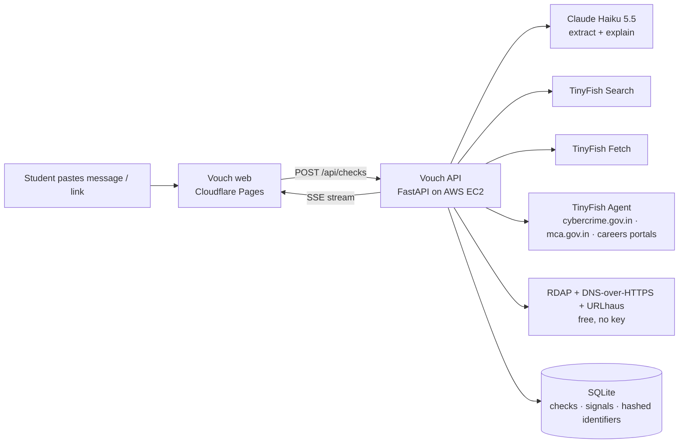

# Vouch

**Know before you say yes.** Vouch checks whether a job or internship offer is real in about 30 seconds, using live web evidence gathered through TinyFish and scored by a deterministic rule engine. Claude Haiku 5.5 only reads the message and explains the result; it never decides the verdict.

Live: https://vouch.spacesdrive.cc · API: https://api.vouch.spacesdrive.cc/healthz

## How it works



1. **Extract.** Haiku reads the pasted text or link and pulls out company, role, sender emails, phones, UPI ids, URLs and any money request. A regex pass runs in parallel as a safety net.
2. **Verify, all in parallel.** Each of the 12 signals has its own time budget. TinyFish Search finds the official site, scam reports, registry pages and news; TinyFish Fetch reads them; RDAP and DNS answer domain age and mail records. Slow checks (the three TinyFish Agent runs) are enqueued at once and land whenever they finish.
3. **Verdict with receipts.** Score = clamp(50 + Σ red − Σ green, 0, 100). Green 0–29, amber 30–59, red 60–100. A preliminary verdict appears in under 8 s; the final one after the Agent checks, capped at 75 s. Every receipt links to the page it came from.

## The 12 signals and where TinyFish does the work

| # | Signal | Source |
|---|--------|--------|
| S1 | Money asked | Haiku extraction + regex |
| S2 | Sender domain vs official domain | TinyFish Search (official site) + lookalike check |
| S3 | Domain age & registrar | RDAP |
| S4 | Mail & web records | DNS over HTTPS |
| S5 | Scam reports | TinyFish Search (web + news) + TinyFish Fetch |
| S6 | Cybercrime suspect registry | TinyFish Agent on cybercrime.gov.in |
| S7 | Company registry (MCA) | TinyFish Search → Fetch; Agent fallback on mca.gov.in |
| S8 | Role on official careers page | TinyFish Fetch; Agent fallback inside the careers portal |
| S9 | Contact channel | Haiku extraction |
| S10 | Pressure / too good to be true | Haiku extraction |
| S11 | Site consistency | TinyFish Fetch both sites, Haiku compares |
| S12 | URL reputation | URLhaus |

Hard rules: a money request alone forces at least **BE CAREFUL**; a money request plus a lookalike domain, a credible scam report or a suspect-registry hit forces **HIGH RISK**.

## Beyond the check: watches and company research

- **Watches** (`/app/watches`): watch a careers page, an ATS board or a LinkedIn company page. Tell Vouch the field and roles you want (presets that filter as you type, or plain language that Claude parses) and optionally add a resume. New postings are found through TinyFish Search restricted to the careers host, TinyFish Fetch, or a TinyFish Agent for JavaScript-only boards, scored against your preferences, and raised as alerts (`/app/alerts`) when the match is at or above your threshold. Scheduling uses TinyFish Monitor with an in-process fallback. Users can connect their own LinkedIn through a TinyFish browser profile for login-walled pages (opt-in, read-only).
- **Company research** (`/app/company`): before joining, an organised and sourced dossier on culture, work-life balance, pay, management, layoffs and firing practice, treatment of freshers, growth and hiring. Evidence comes from TinyFish Search across Reddit, AmbitionBox, Glassdoor, Blind, X, LinkedIn posts and news, TinyFish Fetch of readable pages, and Claude organising it with every quote tied to a source URL that was actually opened. "Try a sample" loads a precomputed dossier instantly; "Run live sample" streams a fresh run.

## Run it

```bash
cp api/.env.example api/.env   # fill TINYFISH_API_KEY, ANTHROPIC_API_KEY, SECRET_KEY, GOOGLE_CLIENT_ID
make dev-api                    # http://localhost:8000
make dev-web                    # http://localhost:5173
make test
```

Deploy: `make deploy-api` (EC2 via infra/deploy.sh) and `make deploy-web` (Cloudflare Pages). See `infra/README.md`.

## Limitations

- A clean result is not a guarantee. Vouch reports risk signals, never accusations.
- Government portals sometimes show captchas; those checks resolve as "unknown" rather than "pass".
- Phone numbers, emails and UPI ids are stored hashed; only a masked form is displayed.

## Built on the day

Everything in this repository was built on 1 November 2026 during the hackathon. Nothing existed beforehand except the written plan.
